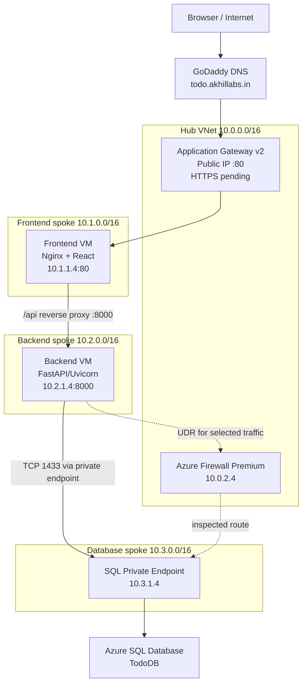

# High-Level Design (HLD)

## 1. Purpose

Design a segmented Azure workload for a small ToDo application using a landing-zone-inspired governance hierarchy and a hub-and-spoke network. The browser enters through Application Gateway; the frontend VM serves React through Nginx; API requests are reverse-proxied to FastAPI on a private backend VM; the backend reaches Azure SQL through a Private Endpoint and Private DNS.

## 2. Scope

### In scope
- Management-group hierarchy and subscription governance
- Hub VNet and three spoke VNets
- Hub-to-spoke VNet peering
- NSGs, NAT Gateway, Azure Firewall, route tables
- Azure SQL private access
- Linux frontend/backend VMs
- Application Gateway HTTP ingress
- GoDaddy DNS A record
- Terraform module patterns using `for_each` and `dynamic`

### Not yet complete in the original lab
- HTTPS listener and certificate binding
- HTTP-to-HTTPS redirect
- Production secrets handling and rotation
- Production monitoring/alerting and formal cost controls
- Full end-to-end route and security review after subscription pause

## 3. Logical architecture

## 4. Components and responsibilities

| Component | Responsibility |
|---|---|
| Management Groups | Apply governance and policy at a scope above subscriptions |
| Hub VNet | Shared connectivity/security services |
| Spoke VNets | Isolate frontend, backend and database tiers |
| VNet Peering | Connect each spoke to the hub; peering is not transitive |
| NSGs | Subnet-level allow/deny controls |
| NAT Gateway | Outbound egress from private subnets; not inbound publishing |
| Azure Firewall | Central network filtering for traffic deliberately routed through it |
| UDRs | Send selected traffic to the firewall next hop |
| Application Gateway | Public Layer 7 HTTP(S) entry point and backend routing |
| Nginx | Serves React static files and reverse-proxies `/api` to FastAPI |
| FastAPI | API and SQL CRUD operations |
| Private Endpoint | Private IP path to Azure SQL |
| Private DNS Zone | Resolves standard SQL FQDN to the private endpoint IP |
| GoDaddy A record | Maps `todo.akhillabs.in` to the Application Gateway public IP |

## 5. Address plan

| Network | CIDR | Subnet / endpoint |
|---|---|---|
| HubVnet | `10.0.0.0/16` | AzureBastionSubnet `10.0.1.0/26` |
| HubVnet | `10.0.0.0/16` | AzureFirewallSubnet `10.0.2.0/26` |
| HubVnet | `10.0.0.0/16` | ApplicationGWSubnet `10.0.3.0/24` |
| HubVnet | `10.0.0.0/16` | SharedSubnet `10.0.4.0/24` |
| Spoke-FE-Vnet | Confirm exact VNet CIDR in Azure | Subnet-FE `10.1.1.0/24`, VM `10.1.1.4` |
| Spoke-BE-VNet | Confirm exact VNet CIDR in Azure | Subnet-BE `10.2.1.0/24`, VM `10.2.1.4` |
| Spoke-DB-VNet | Confirm exact VNet CIDR in Azure | Subnet-DB `10.3.1.0/24`, PE `10.3.1.4` |

The original lab notes imply `10.1.0.0/16`, `10.2.0.0/16`, and `10.3.0.0/16` for the spoke VNet spaces. Confirm them in Azure before reuse; do not create overlapping networks.

## 6. Trust boundaries and flow

1. Internet → Application Gateway public frontend: TCP 80 in the lab; TCP 443 pending.
2. Application Gateway subnet `10.0.3.0/24` → FE VM TCP 80.
3. FE subnet `10.1.1.0/24` → BE VM TCP 8000.
4. BE VM → SQL Private Endpoint TCP 1433, with private DNS resolving the SQL FQDN.
5. For traffic intended to be inspected by Firewall, source and return routes, firewall rules, and effective routes must be validated. Do not claim every SQL packet traverses Firewall solely because a Private Endpoint exists.

## 7. Availability, security, operations

- Application Gateway Standard_v2 was deployed with zone settings shown in the portal; the lab had a single frontend/backend VM, so the application tier itself is not highly available.
- VMs had private addresses and were managed using Azure Portal Run Command because the administrator laptop was not connected to the VNet.
- Use least-privilege NSGs; remove temporary public IP and broad port-80 rules.
- Rotate SQL credentials and use Key Vault or managed identity where supported.
- HTTPS, logging, monitoring, backup/restore, alerting, budget alerts, and policy-as-code should be added before production.
- Azure Firewall Premium, Application Gateway v2, NAT Gateways, VMs, disks and SQL may incur ongoing costs.
